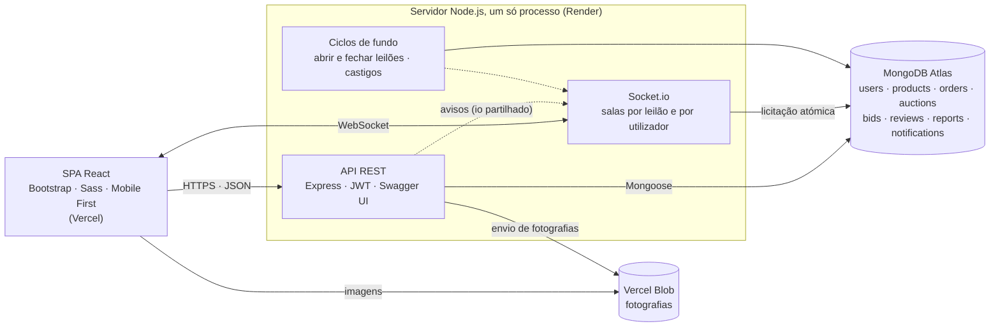
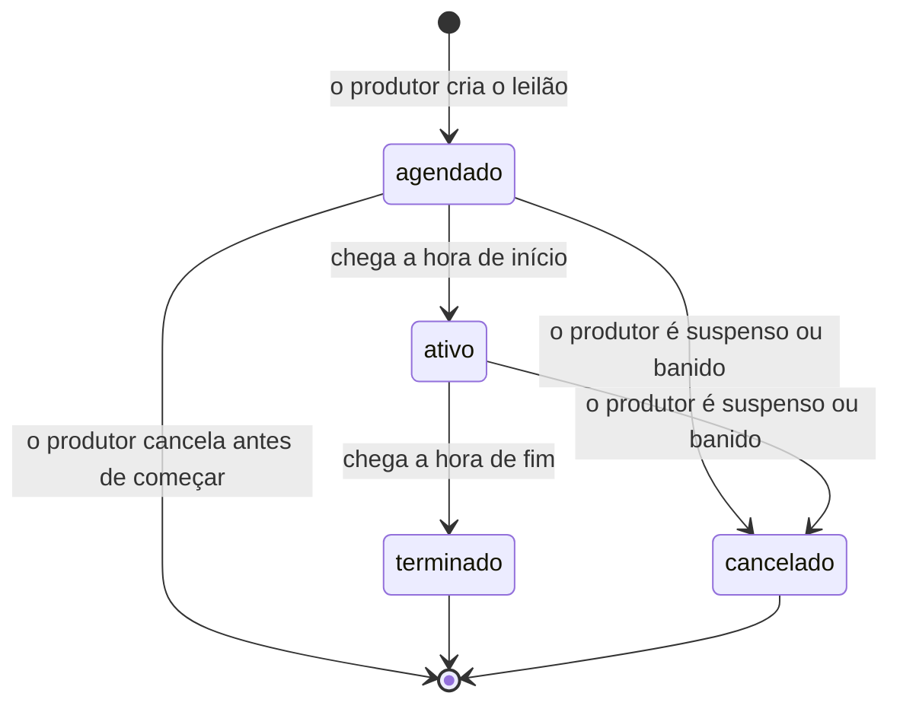
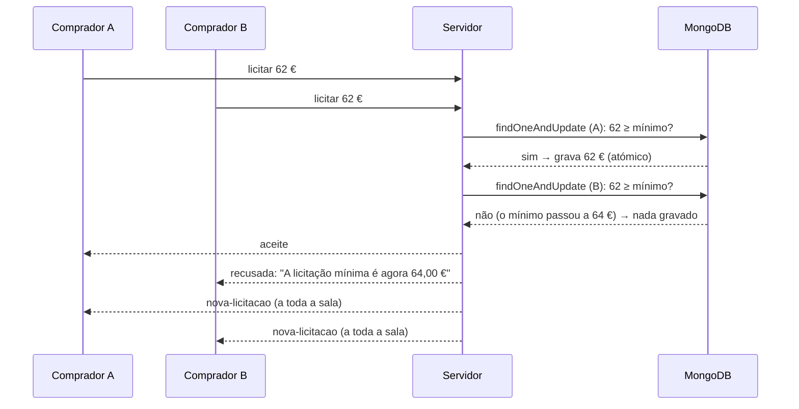

# Do Campo à Mesa

Mercado digital de produtores locais do Alto Minho, com encomendas e leilões em tempo real.

Trabalho prático individual de **Desenvolvimento Web e para a Cloud** · Mestrado em Engenharia Informática · IPVC–ESTG · 2026/2027

**Autor:** Diogo Esteves de Sá, 31378

|                                  | Endereço                                             |
| -------------------------------- | ---------------------------------------------------- |
| Aplicação                        | <https://do-campo-a-mesa.vercel.app>                 |
| API                              | <https://do-campo-a-mesa-dkm4.onrender.com>          |
| Documentação da API (Swagger UI) | <https://do-campo-a-mesa-dkm4.onrender.com/api-docs> |

> A API está no plano gratuito do Render, que a desliga depois de 15 minutos sem visitas. O primeiro pedido depois disso pode demorar cerca de um minuto; os seguintes são imediatos.

Este README é o relatório do projeto e contém as instruções de instalação, execução e publicação.

## Índice

1. [Introdução](#1-introdução)
2. [Arquitetura](#2-arquitetura)
3. [Frontend e SPA](#3-frontend-e-spa)
4. [API REST e documentação](#4-api-rest-e-documentação)
5. [Modelo de dados](#5-modelo-de-dados)
6. [Segurança](#6-segurança)
7. [Tempo real e consistência dos leilões](#7-tempo-real-e-consistência-dos-leilões)
8. [Deployment na Cloud](#8-deployment-na-cloud)
9. [Testes](#9-testes)
10. [Dificuldades e trabalho futuro](#10-dificuldades-e-trabalho-futuro)
11. [Ferramentas e uso de IA](#11-ferramentas-e-uso-de-ia)
12. [Instalação e execução](#12-instalação-e-execução)
13. [Créditos](#13-créditos)

## 1. Introdução

O **Do Campo à Mesa** liga pequenos produtores agrícolas do Alto Minho (hortícolas, fruta, mel, vinho, queijo…) a consumidores e à restauração local. Os produtores publicam os seus produtos e os compradores encomendam, com levantamento na quinta ou entrega em casa. Os lotes da época e os excedentes vão a **leilão em direto**, com vários compradores a licitar ao mesmo tempo.

O objetivo foi construir uma aplicação completa e que funcione a sério: uma SPA responsiva (Mobile First), uma API REST documentada, persistência em MongoDB, comunicação em tempo real com WebSockets e publicação na Cloud. Todos os números que a aplicação mostra (médias, totais, estatísticas, pessoas a ver um leilão) são calculados a partir dos dados; os dados de exemplo existem só para demonstração e aparecem sempre com o selo **"Exemplo"**.

### Intervenientes e funcionalidades

| Interveniente     | O que pode fazer                                                                                                                                                                                                                                                                                                                                                                                               |
| ----------------- | -------------------------------------------------------------------------------------------------------------------------------------------------------------------------------------------------------------------------------------------------------------------------------------------------------------------------------------------------------------------------------------------------------------- |
| **Visitante**     | Explorar o catálogo por categoria, produtor, localidade, época e modo de produção biológico; pesquisar por nome, descrição ou produtor; ver a página pública de cada produtor (história, produtos, avaliações, horário, contactos e mapa); assistir aos leilões em direto; usar o carrinho; criar conta como comprador ou produtor.                                                                            |
| **Comprador**     | Encomendar a vários produtores de uma vez, com levantamento ou entrega; acompanhar o estado de cada encomenda (pendente → confirmada → pronta → entregue) com aviso em tempo real; licitar em leilões; avaliar a encomenda e os produtos; guardar produtores nos favoritos; denunciar avaliações e produtores.                                                                                                 |
| **Produtor**      | Gerir os produtos (preço, stock, épocas, fotografia); personalizar a sua página (capa, logótipo, história, horário de levantamento, contactos, localização no mapa); tratar as encomendas recebidas; criar leilões (com o lote tirado do stock, se quiser) e acompanhá-los em direto; responder às avaliações; consultar estatísticas de vendas, encomendas, leilões e avaliações; ver alertas de stock baixo. |
| **Administrador** | Validar os novos produtores; decidir as denúncias de avaliações (manter ou ocultar) e de produtores (rejeitar, aviso, suspensão ou banimento); ver o painel global (utilizadores, encomendas, leilões a decorrer e pessoas em cada sala) e o estado dos serviços (API, MongoDB, Socket.io, armazenamento das imagens e Swagger), tudo em tempo real.                                                           |

Além do que o enunciado pede, a aplicação tem notificações guardadas (com sino e contador), favoritos, uma página com todos os produtores, denúncias e castigos com motivo e possibilidade de voltar atrás, e o prolongamento automático dos leilões quando há licitações nos últimos 30 segundos.

## 2. Arquitetura



| Componente      | Tecnologia                                             | Responsabilidade                                                                                                                                                            |
| --------------- | ------------------------------------------------------ | --------------------------------------------------------------------------------------------------------------------------------------------------------------------------- |
| SPA             | React 19, Vite 8, React Router 8, Bootstrap 5.3 e Sass | Interface Mobile First dos quatro papéis; estado global da sessão, do carrinho, da ligação em tempo real, das notificações e dos favoritos                                  |
| API REST        | Node.js 24 e Express 5                                 | Recursos `auth`, `products`, `producers`, `orders`, `reviews`, `auctions`, `notifications`, `localidades` e `admin`; autenticação JWT e papéis; documentação em `/api-docs` |
| Tempo real      | Socket.io 4.8, no mesmo servidor HTTP da API           | Salas por leilão e por utilizador; presença; licitações; avisos e notificações                                                                                              |
| Ciclos de fundo | `setInterval` no mesmo processo                        | De 2 em 2 segundos, abre os leilões cuja hora chegou e fecha os que acabaram; de minuto a minuto, levanta as suspensões que chegaram ao fim                                 |
| Base de dados   | MongoDB Atlas (M0) com Mongoose 9                      | Oito coleções, com validação nos schemas                                                                                                                                    |
| Armazenamento   | Vercel Blob (em desenvolvimento, o disco)              | Fotografias dos produtos, capas e logótipos                                                                                                                                 |

**Princípios seguidos:**

- **O servidor é a fonte da verdade.** Valida papéis, stock, estados, datas e licitações, mesmo quando a aplicação web já os valida.
- **A API e o Socket.io partilham o processo.** As rotas REST usam o mesmo objeto `io` para avisar em tempo real (por exemplo, quando o produtor muda o estado de uma encomenda, o comprador vê a mudança sem recarregar a página).
- **Configuração só por variáveis de ambiente.** Os segredos nunca entram no Git; cada aplicação tem um `.env.example` que explica cada variável.
- **Duas aplicações independentes no mesmo repositório.** `api/` e `web/` têm cada uma o seu `package.json` e falam só por HTTP e WebSocket, por isso são publicadas em serviços diferentes.

```
.
├── api/                  servidor: API REST, Socket.io e ciclos de fundo
│   ├── openapi.yaml      especificação OpenAPI (Swagger UI em /api-docs)
│   ├── test/             testes automáticos (node:test)
│   └── src/
│       ├── server.js     servidor HTTP + Socket.io + ciclos
│       ├── app.js        Express: segurança, rotas, imagens e erros
│       └── config/ dados/ middleware/ models/ routes/ scripts/ services/ sockets/ utils/
├── web/                  aplicação web (SPA)
│   ├── vercel.json       endereços tratados pelo React Router no Vercel
│   └── src/
│       ├── main.jsx · App.jsx · rotas.jsx
│       └── api/ components/ context/ hooks/ pages/ styles/
└── README.md             relatório e instruções
```

## 3. Frontend e SPA

### Framework e organização

A aplicação web é uma SPA em **React 19**, criada com **Vite 8**. Escolhi o React pela maturidade do ecossistema, por ser a opção usada nos exemplos do guia e por os componentes com hooks se adaptarem bem a um interface com muito estado partilhado (sessão, carrinho, ligação em tempo real). O código está organizado em:

- **27 páginas** (`web/src/pages/`), carregadas só quando são abertas (`lazy` do React Router), para o ficheiro principal de JavaScript ficar em cerca de 355 KB; o mapa (Leaflet) também só é carregado quando aparece;
- **60 componentes reutilizáveis** (`web/src/components/`), como `CartaoProduto`, `CartaoEncomenda`, `CartaoLeilaoAoVivo`, `ResumoDasAvaliacoes`, `Estrelas`, `GraficoDeColunas`, `Campo` e `Icone`. O "painel de leilão" do enunciado é a página `SalaLeilao`;
- **hooks próprios** (`web/src/hooks/`), entre eles `useLeilao` (a sala de um leilão em tempo real), `useAgora` (o relógio acertado com o do servidor), `useFormulario` (data binding dos formulários e erros por campo vindos da API) e `useEventoSocket` (reagir a um aviso do servidor).

### Estado global

O estado partilhado está em **Context** do React, sem bibliotecas externas:

| Contexto               | O que guarda                                                                                                                                |
| ---------------------- | ------------------------------------------------------------------------------------------------------------------------------------------- |
| `SessaoProvider`       | O utilizador e o token (no `localStorage`, para a sessão ficar depois de recarregar); volta a ler a conta quando o servidor avisa que mudou |
| `CarrinhoProvider`     | As linhas do carrinho, agrupadas por produtor, guardadas no browser (o carrinho funciona sem conta; a conta só é pedida ao encomendar)      |
| `SocketProvider`       | Uma única ligação Socket.io por sessão, que volta a entrar nas salas quando a ligação cai                                                   |
| `NotificacoesProvider` | O número de notificações por ler, atualizado em tempo real                                                                                  |
| `FavoritosProvider`    | Os produtores favoritos (o coração muda logo e volta atrás se o servidor recusar)                                                           |
| `TarefasAdminProvider` | Quantos produtores e denúncias esperam por decisão, para os números na navegação                                                            |

### Routing

O routing é feito no cliente com o **React Router 8** (`createBrowserRouter`, em `web/src/rotas.jsx`), com 28 rotas, página 404, página de erro e títulos próprios em cada página. Início, Produtos, Produtores, Leilões e Carrinho estão abertos a todos; as páginas que precisam de conta mostram uma mensagem com "Entrar" e "Criar conta" em vez de levar o visitante para outro lado, e voltam à página pedida depois de entrar. Os filtros e a pesquisa do catálogo ficam no endereço (`/produtos?categoria=Fruta&biologico=true`), por isso podem ser partilhados e o botão de recuar funciona.

> O guia e o esqueleto usam o `react-router-dom`, que deixou de existir na versão 8 do React Router; o projeto usa o pacote `react-router`.

### Mobile First, breakpoints e Sass

- **Mobile First:** os estilos de base são os do telemóvel, e os ecrãs maiores acrescentam regras com media queries `min-width`, através do mixin `a-partir-de($ponto)`. No telemóvel a navegação é uma barra inferior ao alcance do polegar; a partir de 1024 px passa para o cabeçalho.
- **Breakpoints:** 768 (md), 1024 (lg) e 1280 px (xl), definidos uma só vez em `$grid-breakpoints`, que serve tanto a grelha do Bootstrap como os mixins. O guia misturava os 992/1200 px do Bootstrap com os 1024/1280 px do Sass, o que fazia o layout mudar em larguras quase iguais. O catálogo passa de 2 para 3 e para 4 colunas nestes pontos.
- **Sass com módulos** (`@use`/`@forward`): variáveis (`_variables.scss`, com as escalas de cor e a função `cor()`), mixins (`_mixins.scss`: `a-partir-de` e `vidro-fosco`) e parciais por área (`_cabecalho`, `_navegacao-inferior`, `_produtos`, `_leiloes`, `_encomendas`…).
- **Bootstrap 5.3** configurado pelas nossas variáveis antes de ser compilado (cores, raios, letra, breakpoints): grelha, cartões, formulários, `nav-pills`, alertas e listas.

### Design e acessibilidade

O design é próprio. As cores são escalas de 12 passos geradas em OKLCH a partir de um verde (`#1F7A3D`) e de um laranja (`#C2410C`), com o contraste de todas as combinações usadas a passar o nível AA da WCAG, verificado em cada página no browser. Há **modo escuro** a seguir a preferência do sistema (`prefers-color-scheme`), que só troca os valores das escalas. A letra (Bricolage Grotesque e Plus Jakarta Sans) está guardada no projeto, sem pedidos ao Google. Os ícones são os desenhos SVG do Material Symbols, só os usados, num componente `Icone`.

A aplicação usa HTML semântico (`header`, `nav`, `main`, `article`, `footer` e um `h1` por página), tem a ligação "Saltar para o conteúdo", anuncia as licitações e os avisos aos leitores de ecrã (`aria-live`), e o gráfico das estatísticas funciona com as setas do teclado e tem uma vista em tabela.

## 4. API REST e documentação

A API é feita com **Express 5**, que já apanha os erros das funções `async` (o guia precisava de um utilitário próprio no Express 4). Os recursos são identificados por URI em inglês, como pede o enunciado, e cada operação usa o verbo HTTP certo:

| Recurso              | Operações                                                                                                                                                                                                                                   |
| -------------------- | ------------------------------------------------------------------------------------------------------------------------------------------------------------------------------------------------------------------------------------------- |
| `/api/auth`          | `POST /registo`, `POST /login`, `GET /eu`, `PATCH /eu`                                                                                                                                                                                      |
| `/api/products`      | `GET /`, `POST /`, `GET /meus`, `GET /{id}`, `PUT /{id}`, `DELETE /{id}`, `PUT /{id}/imagem`, `DELETE /{id}/imagem`                                                                                                                         |
| `/api/producers`     | `GET /`, `GET /{id}`, `PUT` e `DELETE /{id}/favorito`, `POST /{id}/denuncias`, `GET` e `PATCH /eu`, `PUT` e `DELETE /eu/{capa ou logotipo}`, `GET /eu/estatisticas`                                                                         |
| `/api/orders`        | `GET /`, `POST /`, `GET /recebidas`, `GET /{id}`, `PATCH /{id}/estado`                                                                                                                                                                      |
| `/api/reviews`       | `GET /`, `POST /`, `GET /{id}`, `PUT /{id}`, `POST /{id}/denuncias`, `PUT` e `DELETE /{id}/resposta`                                                                                                                                        |
| `/api/auctions`      | `GET /`, `POST /`, `GET /meus`, `GET /{id}`, `DELETE /{id}`                                                                                                                                                                                 |
| `/api/notifications` | `GET /`, `PATCH /lidas`                                                                                                                                                                                                                     |
| `/api/localidades`   | `GET /`, `GET /{concelho}/freguesias`                                                                                                                                                                                                       |
| `/api/admin`         | `GET /produtores/pendentes`, `PATCH /produtores/{id}/validacao`, `GET /resumo`, `GET /painel`, `GET /servicos`, `GET /denuncias`, `PATCH /produtores/{id}/moderacao`, `DELETE /produtores/{id}/castigo`, `PATCH /avaliacoes/{id}/moderacao` |
| `/api/health`        | `GET` (o estado da API e da ligação à base de dados)                                                                                                                                                                                        |

**Códigos de resposta:** `200` nas leituras e atualizações; `201` nas criações, com o cabeçalho `Location` quando se cria um só recurso (`POST /api/products`, `/api/reviews` e `/api/auctions`; uma encomenda feita com o carrinho dá uma por produtor); `204` sem corpo nas remoções (`DELETE /api/products/{id}`); `400` para dados inválidos, com a mensagem de cada campo em `detalhes` (a aplicação web mostra-as junto ao campo certo); `401` sem sessão ou com o token inválido ou expirado; `403` sem permissão; `404` para o que não existe; `409` para conflitos (email repetido, stock insuficiente, segunda avaliação da mesma encomenda); `429` quando se passa o limite de tentativas. Os erros são tratados num só sítio (`middleware/erros.js`), sempre em JSON, e os erros `500` respondem só "Erro interno do servidor", com os pormenores no registo do servidor.

**Validação:** os schemas do Mongoose validam tipos, obrigatórios, enumerações, mínimos e máximos, com mensagens em português; as rotas só aceitam os campos permitidos de cada pedido (lista branca), em vez de copiar o `req.body` inteiro.

**Documentação:** a especificação está em `api/openapi.yaml` (**OpenAPI 3.0.3**), com as **53 operações**, os parâmetros, os corpos e as respostas, os schemas em `components` (`Produto`, `Encomenda`, `Leilao`, `Avaliacao`, `Sessao`, `Erro`…) e o esquema de segurança `bearerAuth` (JWT). A Swagger UI está em [`/api-docs`](https://do-campo-a-mesa-dkm4.onrender.com/api-docs), onde se podem experimentar os pedidos com o botão "Authorize". Um script comparou as rotas do Express com a especificação a cada recurso novo, para nenhuma ficar por documentar.

## 5. Modelo de dados

A base de dados tem oito coleções. A regra seguida foi: **embeber** o que pertence a um só documento, é lido sempre com ele e tem tamanho limitado; **referenciar** o que tem vida própria, é partilhado ou cresce sem limite.

| Coleção         | Embebido                                                                                                                                                             | Referenciado                                    | Porquê                                                                                                                                                                                                                              |
| --------------- | -------------------------------------------------------------------------------------------------------------------------------------------------------------------- | ----------------------------------------------- | ----------------------------------------------------------------------------------------------------------------------------------------------------------------------------------------------------------------------------------- |
| `users`         | Os dados de produtor (`produtor`: nome da quinta, localização, história, horário de levantamento, contactos, ponto no mapa, imagens, validação) e o castigo em vigor | Os favoritos (lista de `_id` de produtores)     | Os dados de produtor são 1:1 com a conta e lidos sempre juntos. Os favoritos são poucos por pessoa, mas apontam para outros utilizadores, que mudam por si                                                                          |
| `products`      | As épocas                                                                                                                                                            | O produtor                                      | Um produtor tem muitos produtos, e a página do produtor muda sem tocar nos produtos                                                                                                                                                 |
| `orders`        | As linhas (produto, nome, preço e unidade **no momento da compra**) e o histórico dos estados                                                                        | O comprador, o produtor e cada produto          | A encomenda é um registo: se o preço do produto mudar amanhã, a encomenda de hoje não pode mudar. O histórico tem no máximo cinco passos. O carrinho dá uma encomenda por produtor                                                  |
| `auctions`      | A licitação atual (valor, comprador, nome e data)                                                                                                                    | O produtor, o produto e a encomenda do vencedor | A licitação atual tem de estar no próprio documento do leilão para a condição e a gravação serem **uma só operação atómica** (secção 7)                                                                                             |
| `bids`          | —                                                                                                                                                                    | O leilão e o comprador                          | O histórico de licitações cresce sem limite e é escrito muitas vezes; embebido no leilão, cresceria até ao limite de 16 MB de um documento e tornaria cada licitação mais pesada. Um índice único `{leilao, ordem}` garante a ordem |
| `reviews`       | As estrelas de cada produto (com o nome guardado), a resposta do produtor e a decisão da moderação                                                                   | O autor, o produtor e a encomenda               | Uma avaliação por encomenda (índice único); a resposta e a moderação são uma de cada e só existem com a avaliação                                                                                                                   |
| `reports`       | —                                                                                                                                                                    | A avaliação ou o produtor denunciado, e o autor | As denúncias têm o seu próprio ciclo (por decidir, decidida) e são lidas em listas do administrador; índices únicos parciais impedem a mesma pessoa de repetir uma denúncia por decidir                                             |
| `notifications` | —                                                                                                                                                                    | O utilizador                                    | Muitas por pessoa e lidas em listas; um índice TTL apaga-as sozinhas ao fim de 90 dias                                                                                                                                              |

**Pesquisas:** o catálogo usa `$regex` (pesquisa no nome, na descrição e no produtor, sem distinguir maiúsculas de minúsculas e com os caracteres especiais escapados) e filtra o preço com `$gte` e `$lte`; o stock é confirmado com `$gte` na própria atualização, para nunca ficar negativo; as estatísticas e o painel usam intervalos de datas com `$gte` e `$lt`. As médias das avaliações, as estatísticas do produtor e os números do painel são agregações (`$group`, `$dateToString` no fuso de Portugal), calculadas na leitura, para nunca ficarem desatualizadas.

**Valores monetários:** são guardados em euros com duas casas decimais, e os totais somam-se em cêntimos inteiros, para não haver erros de arredondamento.

**Consistência:** criar uma encomenda (com a descida do stock de cada produto), fechar um leilão (com a encomenda do vencedor ou o lote devolvido ao stock) e cancelar as encomendas de um produtor banido correm em **transações**, para nunca ficarem a meio.

## 6. Segurança

| Medida               | Como está feita                                                                                                                                                                                                                                                                  |
| -------------------- | -------------------------------------------------------------------------------------------------------------------------------------------------------------------------------------------------------------------------------------------------------------------------------- |
| Passwords            | Cifradas com **bcrypt** (custo 12), nunca guardadas nem devolvidas em claro (`passwordHash` com `select: false`); entre 8 caracteres e 72 bytes, o máximo que o bcrypt usa                                                                                                       |
| Sessão               | **JWT** assinado (HS256), com expiração de 2 horas, enviado no cabeçalho `Authorization: Bearer`                                                                                                                                                                                 |
| Papéis               | Middleware `auth(...papeis)` em cada rota protegida: `401` sem token válido, `403` com o papel errado. Os produtores só vendem depois de aprovados pelo administrador, e as contas banidas são recusadas mesmo com um token ainda válido (a conta é confirmada na base de dados) |
| Registo              | Lista branca de campos: o exemplo do enunciado copiava o `req.body` inteiro, o que deixaria alguém registar-se como administrador ou como produtor já aprovado. Os administradores só se criam no terminal (`npm run criar-admin`)                                               |
| CORS                 | Só a aplicação web (`CLIENT_URL`) pode chamar a API e ligar-se ao Socket.io                                                                                                                                                                                                      |
| Cabeçalhos           | **helmet**: Content-Security-Policy, HSTS, proteção contra molduras, `nosniff`, `Referrer-Policy`; o servidor não diz que é Express                                                                                                                                              |
| Limite de tentativas | **express-rate-limit**: 10 tentativas de login falhadas em 15 minutos por endereço IP (passado o limite, até a password certa é recusada) e 10 contas criadas por hora; resposta `429` com os minutos que faltam                                                                 |
| Fotografias          | Recebidas em memória até 5 MB; o tipo é verificado pelos primeiros bytes do ficheiro (JPEG, PNG ou WebP), e não pelo nome; guardadas com um nome aleatório                                                                                                                       |
| Segredos             | Só em variáveis de ambiente; o `.env` está no `.gitignore`; em produção, a base de dados tem um utilizador próprio com permissão só sobre ela                                                                                                                                    |
| HTTPS                | Obrigatório no Render e no Vercel, com HSTS                                                                                                                                                                                                                                      |
| Dependências         | `npm audit --omit=dev` sem vulnerabilidades nas duas aplicações; versões novas instaladas só depois de uma a duas semanas publicadas; uma dependência indireta vulnerável (`zod`, trazida pela biblioteca do Vercel Blob) foi corrigida com `overrides`                          |

**Compromisso assumido:** o token fica no `localStorage`, que fica ao alcance de um script injetado (XSS). A alternativa seria um cookie `httpOnly`, mas o enunciado pede o token no cabeçalho `Authorization`. Para reduzir o risco, o React escapa todo o texto mostrado, nenhum conteúdo dos utilizadores é inserido como HTML, e o token expira ao fim de 2 horas.

## 7. Tempo real e consistência dos leilões

### Como funciona um leilão

Um produtor aprovado põe em leilão um lote de um dos seus produtos. Escolhe a quantidade do lote, na unidade do produto (por exemplo, "9 kg"), o preço base, o incremento, o início (já, ou num dia e hora até 90 dias depois) e a duração, de 2 minutos a 7 dias. Quem tem o produtor nos favoritos é avisado. Os leilões a decorrer aparecem em destaque no Início, e os próximos aparecem na agenda da página Leilões, com o dia e a hora.



### As regras

Todas as regras são verificadas no servidor, mesmo as que a sala também mostra. A maior parte faz parte da condição da operação atómica explicada mais abaixo.

| Regra                                                                                                                                                                                                                                        | Como é garantida                                                                                                                                                   |
| -------------------------------------------------------------------------------------------------------------------------------------------------------------------------------------------------------------------------------------------- | ------------------------------------------------------------------------------------------------------------------------------------------------------------------ |
| **Quem licita:** qualquer pessoa com conta, exceto o administrador. O produtor não licita no próprio leilão. Os visitantes assistem, mas não licitam                                                                                         | No servidor, antes da operação atómica (sem sessão ou administrador) e na própria condição (o produtor). A sala mostra "Entrar para licitar" a quem não tem sessão |
| **Quando:** só entre a hora de início e a hora de fim                                                                                                                                                                                        | Na condição atómica                                                                                                                                                |
| **A primeira licitação** pode ser igual ao preço base                                                                                                                                                                                        | Na condição atómica (`$cond` sobre o número de licitações)                                                                                                         |
| **As seguintes** têm de ser pelo menos a licitação atual mais o incremento, e podem ser mais. Com 60 € e um incremento de 4 €, o mínimo é 64 €                                                                                               | Na condição atómica, arredondado aos cêntimos. A sala mostra sempre o mínimo atualizado e desliga o botão abaixo dele                                              |
| **Os valores** são em euros, maiores do que zero e com até dois decimais                                                                                                                                                                     | No servidor, antes da operação                                                                                                                                     |
| **Quem vai à frente não volta a licitar** até alguém passar à frente: ninguém sobe o preço contra si próprio                                                                                                                                 | Na condição atómica. Recusa: "A sua licitação já é a mais alta"                                                                                                    |
| **Prolongamento:** uma licitação nos últimos 30 segundos faz o relógio voltar aos 30 segundos. Repete-se sempre que há licitações no fim, por isso o leilão só acaba quando passam 30 segundos sem ninguém licitar                           | Na mesma operação atómica, com `$max` sobre a hora de fim. O fecho volta a confirmar a hora antes de fechar                                                        |
| **Atalhos de +5, +10 e +25 €:** somam à licitação atual, sem ficar abaixo do mínimo                                                                                                                                                          | Na sala. O servidor volta a confirmar o valor                                                                                                                      |
| **Lote tirado do stock** (opcional): a quantidade sai do stock do produto ao criar o leilão, só se chegar, e volta ao produto se o leilão for cancelado ou acabar sem licitações                                                             | Numa transação, ao criar, ao fechar e ao cancelar                                                                                                                  |
| **Cancelar:** o produtor só cancela um leilão que ainda não começou                                                                                                                                                                          | Numa só operação. Depois de começar, a API responde `409`                                                                                                          |
| **Fim com licitações:** ganha a licitação mais alta. O vencedor recebe logo uma encomenda do lote, já confirmada, para levantar na quinta, que segue os estados normais (pronta e entregue). O vencedor e o produtor recebem uma notificação | Na transação do fecho                                                                                                                                              |
| **Fim sem licitações:** o leilão termina sem vencedor                                                                                                                                                                                        | Na transação do fecho                                                                                                                                              |
| **Produtor suspenso ou banido:** os leilões dele que ainda não acabaram são cancelados, as licitações deixam de contar e quem licitou é avisado                                                                                              | Ao aplicar o castigo                                                                                                                                               |
| **Conta bloqueada:** não licita, mesmo com um token ainda válido                                                                                                                                                                             | A conta é confirmada na base de dados a cada licitação                                                                                                             |

### Um exemplo

Um leilão de 2 minutos com preço base de 20 € e incremento de 4 €, entre a Ana e o Bruno:

| Falta | Quem  | Licitação           | O que acontece                                                                                                     | Mínimo a seguir |
| ----- | ----- | ------------------- | ------------------------------------------------------------------------------------------------------------------ | --------------- |
| 1:45  | Ana   | 20 €                | Aceite: a primeira pode ser o preço base                                                                           | 24 €            |
| 1:40  | Ana   | 24 €                | Não pode: vai à frente. A sala desliga o formulário, e o servidor recusaria com "A sua licitação já é a mais alta" | 24 €            |
| 1:30  | Bruno | 22 €                | Abaixo do mínimo: a sala não deixa enviar                                                                          | 24 €            |
| 1:20  | Bruno | 30 € (atalho +10 €) | Aceite: pode licitar acima do mínimo                                                                               | 34 €            |
| 0:20  | Ana   | 34 €                | Aceite, e o relógio volta aos 0:30                                                                                 | 38 €            |
| 0:00  | —     | —                   | Passam 30 segundos sem licitações: a Ana ganha por 34 € e recebe a encomenda                                       | —               |

Se, aos 1:30, o Bruno e uma terceira pessoa licitassem os dois 24 € no mesmo instante, só uma das licitações passava, e a outra recebia "A licitação mínima é agora 28,00 €". É o desafio central do trabalho, explicado mais abaixo.

### Salas e eventos

O Socket.io corre no mesmo servidor HTTP da API. Quem tem sessão envia o token ao ligar e entra na sua **sala pessoal** (`user:<id>`), por onde recebe os avisos. Cada leilão tem a sua **sala** (`leilao:<id>`). Os visitantes também ligam, mas só assistem: não podem licitar.

| Evento                                                      | Sentido                         | Para quê                                                                                      |
| ----------------------------------------------------------- | ------------------------------- | --------------------------------------------------------------------------------------------- |
| `entrar` / `sair`                                           | cliente → servidor              | Entrar na sala de um leilão (e sair ao mudar de página)                                       |
| `estado`                                                    | servidor → quem entrou          | O leilão, as últimas licitações e a **hora do servidor**, para o cliente acertar o relógio    |
| `presenca`                                                  | servidor → sala                 | Quantas **pessoas** estão a ver (cada utilizador conta uma vez, mesmo com vários separadores) |
| `licitar`                                                   | cliente → servidor              | `{ leilaoId, valor }`, com resposta (ack) a dizer se foi aceite                               |
| `nova-licitacao`                                            | servidor → sala                 | A licitação aceite, o novo mínimo e a hora de fim (que pode ter sido prolongada)              |
| `recusada`                                                  | servidor → quem licitou         | O motivo da recusa (abaixo do mínimo, leilão acabado, já tem a mais alta…)                    |
| `aberto` / `terminado` / `cancelado`                        | servidor → sala                 | Mudanças de estado do leilão                                                                  |
| `leilao-ganho` / `leilao-terminado`                         | servidor → vencedor / produtor  | O resultado do leilão                                                                         |
| `notificacao`                                               | servidor → pessoa               | Uma notificação nova (também guardada na base de dados)                                       |
| `encomenda-atualizada` / `nova-encomenda`                   | servidor → comprador / produtor | Mudanças nas encomendas, que atualizam as listas sem recarregar                               |
| `conta-validada` / `conta-mudou`                            | servidor → pessoa               | Aprovação do produtor, castigos (uma conta banida termina a sessão logo)                      |
| `painel-mudou` / `produtores-mudaram` / `denuncias-mudaram` | servidor → administradores      | Atualizar o painel e os contadores em tempo real                                              |

Na aplicação web, o hook `useLeilao(id)` junta tudo isto numa sala: contagem decrescente sincronizada, número de pessoas, atalhos de +5, +10 e +25 €, o mínimo sempre atualizado, o histórico de licitações e a mensagem quando uma licitação é recusada. Ao sair da página, o cliente sai da sala; um visitante desliga o socket.

### O desafio central: duas licitações quase ao mesmo tempo

Se a validação ("o valor chega ao mínimo?") e a gravação fossem dois passos, dois compradores podiam ler a mesma licitação atual, passar os dois na validação e gravar os dois. A solução é fazer **a condição e a gravação numa só operação atómica** no MongoDB (`findOneAndUpdate`), que o MongoDB executa sobre um documento de cada vez:

```js
// api/src/sockets/leiloes.js (resumido)
const leilao = await Auction.findOneAndUpdate(
  {
    _id: leilaoId,
    estado: { $in: ['agendado', 'ativo'] },
    iniciaEm: { $lte: agora },
    terminaEm: { $gt: agora },
    produtor: { $ne: utilizador.id }, // o produtor não licita no próprio leilão
    'licitacaoAtual.comprador': { $ne: utilizador.id }, // nem quem já tem a mais alta
    $expr: {
      $cond: [
        { $eq: ['$numeroDeLicitacoes', 0] },
        { $gte: [valor, '$precoBase'] }, // a 1.ª pode ser o preço base
        { $gte: [valor, { $round: [{ $add: ['$licitacaoAtual.valor', '$incremento'] }, 2] }] },
      ],
    },
  },
  [{ $set: { licitacaoAtual: {/* valor, comprador, nome, data */}, numeroDeLicitacoes: { $add: ['$numeroDeLicitacoes', 1] },
             terminaEm: { $max: ['$terminaEm', agora + 30 s] } } }],
  { returnDocument: 'after', updatePipeline: true },
);
if (!leilao) return recusar(motivo); // outra licitação chegou primeiro
```



Só **depois** de aceite é que a licitação vai para o histórico e é anunciada a toda a sala. Pormenores que tiveram de ser resolvidos:

- **Ordem do histórico:** com licitações ao mesmo tempo, a ordem em que eram gravadas na coleção `bids` podia trocar-se. Cada licitação passou a levar o número que a própria operação atómica lhe deu (`numeroDeLicitacoes`), com um índice único `{leilao, ordem}`, e o cliente só avança por esse número.
- **Prolongamento (anti-sniping):** uma licitação nos últimos 30 segundos empurra o fim para 30 segundos depois dela, na mesma operação atómica (uma atualização em _pipeline_, com `$max` sobre a hora de fim). Assim ninguém ganha à última hora sem os outros poderem responder.
- **Relógio:** o servidor envia `terminaEm` e a sua hora atual; cada cliente calcula a diferença para o próprio relógio e conta o tempo a partir daí, por isso todos veem a mesma contagem mesmo com o relógio do telemóvel errado.
- **Fecho:** um ciclo de 2 em 2 segundos abre os leilões cuja hora chegou e fecha os que acabaram, numa transação que volta a confirmar a hora de fim (um leilão prolongado não fecha à hora antiga) e cria a encomenda do vencedor, já confirmada, ou devolve o lote ao stock. Se o servidor estiver parado (o Render adormece), os leilões atrasados são fechados quando ele acorda, com a hora de fim certa.
- **Presença:** conta pessoas únicas e é atualizada no evento `disconnecting`, para quem fecha o separador deixar logo de contar.

A consistência está provada por testes automáticos com sockets reais (secção 9), entre eles "com duas licitações iguais ao mesmo tempo, aceita só uma" e "com muitas licitações ao mesmo tempo, o histórico fica sempre coerente" (oito licitações diferentes em simultâneo). Também a testei à mão em dois telemóveis, com toques quase ao mesmo tempo: fica a primeira e a outra é recusada.

## 8. Deployment na Cloud

### Serviços e modelo de serviço

| Parte           | Serviço                                                                                                                              | Modelo                            | Plano            |
| --------------- | ------------------------------------------------------------------------------------------------------------------------------------ | --------------------------------- | ---------------- |
| Aplicação web   | **Vercel** (site estático numa CDN, publicado a partir do `main` do GitHub)                                                          | PaaS                              | Hobby (gratuito) |
| API + Socket.io | **Render** Web Service (processo Node.js 24 com WebSockets, publicado a partir do `main`, com verificação de saúde em `/api/health`) | PaaS                              | Gratuito         |
| Base de dados   | **MongoDB Atlas** M0 (MongoDB 8.0, na Azure, Holanda)                                                                                | Base de dados como serviço (PaaS) | Gratuito         |
| Fotografias     | **Vercel Blob** (armazenamento de ficheiros com CDN)                                                                                 | Armazenamento como serviço        | Gratuito         |

**Porquê PaaS:** o código continua a ser o nosso (Express, Socket.io, Mongoose), mas o sistema operativo, os certificados HTTPS, os reinícios e a publicação ficam com o fornecedor. Num **IaaS** (uma máquina virtual) teria de instalar e atualizar o sistema, configurar um proxy com HTTPS e manter o processo a correr, o que é mais trabalho e mais risco sem nada de novo para a aplicação. Um **BaaS** (por exemplo, Firebase ou Supabase) substituiria a API, a base de dados e o Socket.io, que são precisamente o que o trabalho pede para construir.

**Porquê estes fornecedores:** os exemplos do enunciado usam a Azure (App Service, Static Web Apps e Blob Storage) com os créditos do Azure for Students. Tentei ativá-los com a conta do IPVC, mas a Microsoft respondeu "Não é elegível para uma conta gratuita do Azure", e o diretório do IPVC não tem nenhuma subscrição. Com o acordo do professor, escolhi outros serviços PaaS gratuitos:

- o **Vercel** serve bem a aplicação web, mas não a API: os WebSockets estão em beta, cada ligação dura no máximo 5 minutos e as ligações podem ficar em instâncias diferentes sem estado partilhado (dois compradores no mesmo leilão podiam não ver as licitações um do outro); além disso, os ciclos de fundo precisam de um processo sempre ligado;
- o **Render** corre a API como um processo Node.js normal, igual ao do computador;
- o disco do Render gratuito apaga-se a cada publicação, por isso as fotografias vão para o **Vercel Blob**. Sem a chave do Blob (no computador e nos testes), continuam a ser guardadas no disco.

### Configuração

| Serviço | Variáveis de ambiente                                                                                                                                                                                                                                                                                                                                |
| ------- | ---------------------------------------------------------------------------------------------------------------------------------------------------------------------------------------------------------------------------------------------------------------------------------------------------------------------------------------------------- |
| Render  | `NODE_VERSION=24`, `MONGODB_URI` (base de dados `do-campo-a-mesa`), `JWT_SECRET` (gerado à sorte, diferente do de desenvolvimento), `JWT_EXPIRES_IN=2h`, `CLIENT_URL` (o endereço do Vercel, sem barra no fim), `BLOB_READ_WRITE_TOKEN`, `TRUST_PROXY=1` (há um proxy à frente da API, e os limites de tentativas contam pelo endereço de quem pede) |
| Vercel  | `VITE_API_URL` (o endereço do Render); o `web/vercel.json` manda todos os endereços para o `index.html`, para o React Router os tratar                                                                                                                                                                                                               |

Cada `git push` para o `main` volta a publicar as duas partes. Há três bases de dados no mesmo cluster do Atlas: desenvolvimento (`do-campo-a-mesa-dev`), testes (`-teste`, criada e apagada pelos próprios testes) e produção (`do-campo-a-mesa`). A produção arrancou com uma cópia dos dados de desenvolvimento (com os mesmos identificadores, as fotografias passadas para o Blob e uma password nova para o administrador), para a demonstração ter conteúdo.

### Custos e limites

O custo é **0 €**: todos os serviços estão em planos gratuitos. Os limites que importam:

- o Render desliga a API ao fim de 15 minutos sem visitas e demora cerca de um minuto a acordar; tem 750 horas por mês, o suficiente para um serviço sempre ligado;
- o Vercel Blob tem 1 GB e 2 000 envios por mês; se passar o limite, deixa de funcionar mas não cobra (a página "Serviços" do administrador avisa);
- o Atlas M0 tem 512 MB.

Para manter a API sempre acordada seria preciso um plano pago do Render. Com mais do que uma instância da API, seria preciso um adapter partilhado no Socket.io (Redis ou MongoDB) para as licitações chegarem a quem está ligado a outra instância; os leilões já fecham bem com várias instâncias, porque o fecho é uma operação condicional na base de dados.

## 9. Testes

A API tem **132 testes automáticos** (`npm test`), escritos com o `node:test` e o `fetch` do próprio Node, sem dependências novas. Correm contra uma base de dados própria (com o sufixo `-teste`), apagada no fim, e os de tempo real usam sockets reais.

| Ficheiro                                    | O que testa                                                                                                                            |
| ------------------------------------------- | -------------------------------------------------------------------------------------------------------------------------------------- |
| `contas.test.js`                            | Registo com lista branca, login, tokens inválidos, expirados ou com outro segredo, papéis, validação de produtores                     |
| `produtos.test.js`                          | CRUD dos produtos (201 com `Location`, 204), filtros e pesquisa, permissões, fotografias (tipo verificado pelos bytes, limite de 5 MB) |
| `encomendas.test.js`                        | Encomendas com o stock numa transação, estados, levantamento e entrega                                                                 |
| `leiloes.test.js`                           | Criação, agenda, cancelamento, stock do lote, presença, licitações simultâneas, prolongamento, fecho e encomenda do vencedor           |
| `avisos.test.js`                            | Avisos em tempo real nas salas pessoais (chegam aos dispositivos certos e só a eles)                                                   |
| `avaliacoes.test.js`, `denuncias.test.js`   | Avaliações, respostas, médias, denúncias e moderação (também com pedidos simultâneos)                                                  |
| `produtores.test.js`, `favoritos.test.js`   | Página do produtor, imagens com tamanho mínimo, favoritos, ordens e pesquisa                                                           |
| `castigos.test.js`                          | Avisos, suspensões, banimento, encomendas canceladas e levantar castigos                                                               |
| `estatisticas.test.js`, `painel.test.js`    | Estatísticas do produtor, painel e estado dos serviços                                                                                 |
| `seguranca.test.js`, `documentacao.test.js` | Cabeçalhos de segurança, limite de tentativas e Swagger UI                                                                             |

Saída da última execução:

```
$ npm test
✔ avaliar uma encomenda (14345.558292ms)
✔ médias e lista das avaliações (12111.9445ms)
✔ mudar uma avaliação e responder (9775.410792ms)
✔ avisos em tempo real (6041.788583ms)
✔ notificações guardadas (2254.510917ms)
✔ denunciar um produtor (6204.155542ms)
✔ decisão do administrador (7347.074375ms)
✔ suspensão (8314.587417ms)
✔ banimento (7689.845833ms)
✔ registo (4747.476333ms)
✔ início de sessão (2032.152083ms)
✔ sessão (1327.833708ms)
✔ validação de produtores (5148.621666ms)
✔ localidades (208.029917ms)
✔ dados pessoais (1680.564792ms)
✔ denunciar uma avaliação (19912.16425ms)
✔ moderar as avaliações denunciadas (27905.542084ms)
✔ produtores por validar (1480.81975ms)
✔ mostra a documentação da API em /api-docs (18.655541ms)
✔ encomendar (14878.010416ms)
✔ acompanhar as encomendas (7439.614125ms)
✔ estatísticas do produtor (6357.817625ms)
✔ favoritos (7803.281125ms)
✔ página dos produtores (12489.109208ms)
✔ criar leilões (9791.583334ms)
✔ lote tirado do stock (5702.497167ms)
✔ sala do leilão (Socket.io) (13609.057292ms)
✔ quem já está a ganhar (2271.285083ms)
✔ licitações nos últimos segundos (7137.364042ms)
✔ fim do leilão (3425.11925ms)
✔ lista dos produtores (5237.641042ms)
✔ painel do administrador (5317.744917ms)
✔ estado dos serviços (1068.671708ms)
✔ página do produtor (5005.208584ms)
✔ dimensões das imagens (102.266583ms)
✔ catálogo (9496.652291ms)
✔ gestão dos produtos (5255.713292ms)
✔ fotografias (2747.554333ms)
✔ cabeçalhos de segurança (22.792458ms)
✔ limite de tentativas (12.165416ms)
ℹ tests 132
ℹ suites 39
ℹ pass 132
ℹ fail 0
ℹ cancelled 0
ℹ skipped 0
ℹ todo 0
ℹ duration_ms 269941.379291
```

Além dos testes automáticos, cada funcionalidade foi verificada no browser antes de ser dada por terminada, no telemóvel (375 px) e no computador, nos modos claro e escuro, com a consola sem erros e os contrastes medidos. Antes de cada commit correram o ESLint, o Prettier e o build da aplicação web (não usei integração contínua, porque não é pedida). O histórico tem mais de 100 commits no `main`, pequenos e graduais, desde 10 de outubro.

## 10. Dificuldades e trabalho futuro

### Dificuldades

- **Licitações ao mesmo tempo.** A operação atómica resolveu a aceitação, mas os testes com oito licitações simultâneas mostraram que a ordem do histórico podia trocar-se; resolvido com o número de ordem dado pela própria operação atómica (secção 7). Depois, o prolongamento obrigou a confirmar outra vez a hora de fim no fecho, para um leilão prolongado não fechar à hora antiga.
- **Base de dados com o nome em falta.** O primeiro teste ligou-se a uma base de dados chamada `test`, porque faltava o nome no fim do endereço do Atlas, e o MongoDB não avisa. O servidor passou a recusar arrancar sem esse nome. Noutra rede (o hotspot do telemóvel), o DNS não resolvia o endereço `mongodb+srv`; era um problema da rede, não da aplicação.
- **Listas de sugestões no telemóvel.** O `datalist` do HTML, usado no concelho e na freguesia, não aparece em todos os browsers do telemóvel. Foi substituído por uma lista própria no padrão "combobox" do W3C (setas, Enter, Escape, leitores de ecrã).
- **Tamanho do JavaScript.** Com o mapa e as páginas novas, o ficheiro principal passou dos 500 KB; as páginas secundárias e o Leaflet passaram a carregar só quando são abertos, e o principal ficou em cerca de 355 KB.
- **Sass e variáveis do CSS.** Dentro de propriedades CSS próprias (`--painel-texto`), o Sass não calcula as suas variáveis sem `#{…}`, e uma mudança deixou o texto literal `v.$branco` no CSS; apanhado na verificação antes do commit.
- **Publicação.** A Azure não aceitou a conta do IPVC; o Vercel não serve para uma API com Socket.io; o disco do Render gratuito apaga as fotografias (daí o Vercel Blob). No fim, o browser bloqueava os pedidos à API porque o `CLIENT_URL` tinha uma barra no fim e a origem enviada pelo browser não tem.
- **Dependências.** A biblioteca do Vercel Blob trazia uma versão vulnerável do `zod`; resolvido com `overrides`. A escolha de versões com uma a duas semanas de publicação evitou pacotes acabados de sair.
- **Materiais de apoio.** O guia e o esqueleto tinham pequenos erros, já referidos nas secções anteriores: o `react-router-dom` (que deixou de existir), os breakpoints misturados, o registo com `...req.body`, a presença a contar separadores em vez de pessoas e o `yamljs` sem manutenção (trocado pelo `yaml`).

### Limitações e trabalho futuro

- A API no plano gratuito do Render adormece (secção 8).
- Uma só instância da API; para escalar, um adapter partilhado no Socket.io.
- Para correr a sério faltariam pagamentos, recuperação da password, as obrigações do RGPD e cópias de segurança automáticas.
- O backoffice em Laravel e a análise de elasticidade (valorizações opcionais) não foram feitos; a administração está na própria SPA.

## 11. Ferramentas e uso de IA

### Ferramentas e bibliotecas

| Área            | Ferramentas e bibliotecas                                                                                                                      |
| --------------- | ---------------------------------------------------------------------------------------------------------------------------------------------- |
| Desenvolvimento | VS Code, Node.js 24+ e npm, Git e GitHub (com o GitHub CLI), ESLint e Prettier, MongoDB Atlas, ferramentas de programador do browser           |
| Aplicação web   | React 19, React Router 8, Vite 8, Bootstrap 5.3, Sass, Socket.io client, Leaflet com OpenStreetMap, Fontsource                                 |
| API             | Express 5, Mongoose 9, Socket.io 4.8, jsonwebtoken, bcryptjs, cors, helmet, express-rate-limit, multer, swagger-ui-express, yaml, @vercel/blob |
| Publicação      | Vercel, Render, MongoDB Atlas, Vercel Blob                                                                                                     |

### Declaração de uso de IA

Usei o **Claude** (Anthropic), através do Claude Code, como assistente na construção da aplicação: para escrever e rever código seguindo as minhas indicações, pesquisar alternativas, verificar o funcionamento no browser e escrever testes e documentação.

Todas as decisões passaram por mim. Fui eu que guiei o Claude, dizendo como queria cada coisa (o que fazer, por que ordem, como devia ficar) e corrigindo o que não estava como eu queria, e fui eu que defini as ferramentas a usar: as do enunciado e do guia, e as que o Claude propôs, que só entraram depois de mas explicar e de eu as aprovar. Testei a aplicação ao longo do trabalho, no computador e no telemóvel, e sei explicar todas as partes do código.

**Design:** pedi que o design não partisse de templates, mas de pesquisa no GitHub e noutras fontes sobre o que se faz de mais atual. As referências do GitHub usadas foram:

- [radix-ui/colors](https://github.com/radix-ui/colors): escalas de cor de 12 passos com papéis fixos (fundos, componentes, bordas, sólidos, texto);
- [shadcn-ui/ui](https://github.com/shadcn-ui/ui): estilos que mudam só os raios, o espaçamento e a densidade;
- [design-tokens/community-group](https://github.com/design-tokens/community-group): o formato W3C de design tokens;
- [google/material-design-icons](https://github.com/google/material-design-icons): os desenhos do Material Symbols;
- [twbs/bootstrap](https://github.com/twbs/bootstrap): a versão 5.3 e a configuração por variáveis Sass;
- [ColorlibHQ/AdminLTE](https://github.com/ColorlibHQ/AdminLTE) e [tabler/tabler](https://github.com/tabler/tabler): os temas Bootstrap mais populares, que são painéis de administração, o que mostrou que valia a pena um tema próprio, pensado para uma loja.

A partir dessa pesquisa foram feitas três propostas visuais e um protótipo interativo; escolhi as cores e o estilo, e aprovei o protótipo antes de a aplicação ser construída.

## 12. Instalação e execução

### Requisitos

- [Node.js](https://nodejs.org/) 24 ou mais recente (inclui o npm)
- Git
- Uma base de dados MongoDB, por exemplo um cluster gratuito no [MongoDB Atlas](https://www.mongodb.com/atlas)

### Servidor (API)

```bash
cd api
npm install            # só na primeira vez, ou quando mudam as dependências
cp .env.example .env   # cria o ficheiro de configuração local
```

No ficheiro `.env`, preencher `MONGODB_URI` com o endereço de ligação à base de dados, incluindo o nome dela no fim do endereço, e `JWT_SECRET` com um valor gerado à sorte. O `.env` tem segredos e nunca vai para o Git; o `.env.example` explica cada variável e como gerar o segredo.

```bash
npm run dev            # API em http://localhost:3000
```

Para confirmar que está a funcionar, abrir <http://localhost:3000/api/health>. A documentação da API (Swagger UI), onde se podem experimentar os pedidos, fica em <http://localhost:3000/api-docs>.

O registo público só cria compradores e produtores. A conta de administrador cria-se no terminal, com `npm run criar-admin`.

| Comando                | O que faz                                                                                                                                                                    |
| ---------------------- | ---------------------------------------------------------------------------------------------------------------------------------------------------------------------------- |
| `npm run dev`          | Arranca a API com o `.env` e reinicia-a sempre que um ficheiro é guardado                                                                                                    |
| `npm start`            | Arranca a API em produção, onde as variáveis de ambiente vêm da plataforma e não do `.env`                                                                                   |
| `npm test`             | Corre os testes numa base de dados própria, com o sufixo `-teste`, apagada no fim, e com os limites de tentativas desligados (`test/testes.env`)                             |
| `npm run criar-admin`  | Cria uma conta de administrador, pedindo os dados no terminal                                                                                                                |
| `npm run exemplo`      | Junta produtores, produtos e leilões de exemplo, com o selo "Exemplo". Os que já existem ficam; os leilões voltam a ser marcados a partir de agora (`-- --apagar` tira tudo) |
| `npm run lint`         | Verifica o código com o ESLint                                                                                                                                               |
| `npm run format`       | Formata o código com o Prettier                                                                                                                                              |
| `npm run format:check` | Confirma que o código está formatado, sem o alterar                                                                                                                          |

### Frontend (SPA)

```bash
cd web
npm install      # só na primeira vez, ou quando mudam as dependências
npm run dev      # servidor de desenvolvimento em http://localhost:5173
```

Em desenvolvimento, o Vite passa os pedidos a `/api`, `/uploads`, `/api-docs` e `/socket.io` à API em `http://localhost:3000`, por isso o servidor tem de estar a correr noutro terminal. Na publicação, o endereço da API define-se em `VITE_API_URL` (ver `.env.example`).

As alterações aos ficheiros aparecem no browser assim que são guardadas. Para abrir a aplicação no telemóvel (na mesma rede Wi-Fi), correr `npm run dev -- --host` e abrir o endereço indicado em "Network".

| Comando                | O que faz                                                 |
| ---------------------- | --------------------------------------------------------- |
| `npm run dev`          | Servidor de desenvolvimento com recarregamento automático |
| `npm run lint`         | Verifica o código com o ESLint                            |
| `npm run format`       | Formata o código com o Prettier                           |
| `npm run format:check` | Confirma que o código está formatado, sem o alterar       |
| `npm run build`        | Gera a versão de produção em `web/dist/`                  |
| `npm run preview`      | Serve localmente a versão de produção                     |

### Publicação

1. **MongoDB Atlas:** criar a base de dados de produção (basta escolher o nome no fim do endereço) e um utilizador com `readWrite` só nela; em Network Access, permitir o acesso do Render (os endereços do plano gratuito mudam).
2. **Vercel Blob:** criar um armazenamento **público** e copiar a chave `BLOB_READ_WRITE_TOKEN`.
3. **Render:** criar um Web Service a partir do repositório, com a raiz `api`, o comando de build `npm ci --omit=dev`, o de arranque `npm start`, a verificação de saúde em `/api/health` e as variáveis da [secção 8](#configuração).
4. **Vercel:** importar o repositório com a raiz `web` (o Vercel deteta o Vite) e a variável `VITE_API_URL` com o endereço do Render.
5. **No Render**, pôr em `CLIENT_URL` o endereço do Vercel, sem barra no fim.
6. Criar o primeiro administrador no computador, apontando para a base de dados de produção: `MONGODB_URI="…" npm run criar-admin` (a variável da consola tem prioridade sobre o `.env`).

## 13. Créditos

- **Ícones:** desenhos do [Material Symbols](https://fonts.google.com/icons), da Google, com licença [Apache 2.0](https://www.apache.org/licenses/LICENSE-2.0). Estão em `web/src/components/Icone.jsx`.
- **Letra:** [Bricolage Grotesque](https://fonts.google.com/specimen/Bricolage+Grotesque) e [Plus Jakarta Sans](https://fonts.google.com/specimen/Plus+Jakarta+Sans), com licença [SIL Open Font License 1.1](https://openfontlicense.org), instaladas através do [Fontsource](https://fontsource.org).
- **Concelhos e freguesias:** [Carta Administrativa Oficial de Portugal (CAOP 2025)](https://dados.gov.pt/datasets/carta-administrativa-oficial-de-portugal-caop2025-continente), da Direção-Geral do Território, com licença [CC BY 4.0](https://creativecommons.org/licenses/by/4.0/). Só os códigos e os nomes, em `api/src/dados/territorio.json`.
- **Mapa:** [Leaflet](https://leafletjs.com), com licença [BSD-2-Clause](https://github.com/Leaflet/Leaflet/blob/main/LICENSE), e os mosaicos e os dados do [OpenStreetMap](https://www.openstreetmap.org/copyright), com licença [ODbL](https://opendatacommons.org/licenses/odbl/). A atribuição aparece no próprio mapa.
