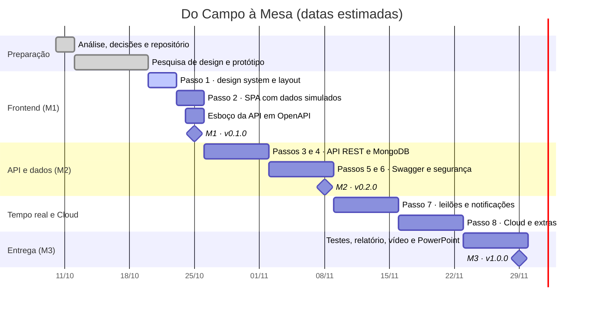

# Plano de trabalho

Funcionalidades a construir, pela ordem das 7 semanas, com as linguagens e ferramentas de cada uma. Cada linha indica se a escolha está prevista nos materiais do docente (enunciado e guia) e, quando não está, porquê.

> As datas são estimadas, a contar da semana 1 a 12 de outubro de 2026. Atualizado a 20 de outubro.

## Linha do tempo

## Como ler as tabelas

- **Previsto?** responde se o docente prevê a escolha:
  - **Sim:** está no enunciado ou no guia.
  - **Outra versão:** está prevista, mas usamos uma versão ou ferramenta equivalente mais atual.
  - **Não:** é uma escolha nossa.
- **Porquê** só é preenchido quando a escolha muda ou não está prevista.

## Preparação (concluída)

| Funcionalidade | Linguagens e ferramentas | Previsto? | Porquê |
|---|---|---|---|
| Repositório e fluxo de trabalho | Git, GitHub (repositório privado), GitHub CLI | Sim (repositório Git partilhado com o docente) · GitHub CLI: Não | O GitHub CLI cria o repositório, os branches e os Pull Requests a partir do terminal. |
| Registo de decisões | Markdown (ADR em `docs/decisoes/`) | Não | Deixa escrito o porquê de cada escolha e alimenta a secção de decisões técnicas do relatório. |
| Pesquisa e protótipo de design | HTML, CSS e JavaScript (protótipo); Python (gerador de cores) | Não (os mockups são orientativos) | Validar o design antes de programar. O Python é só uma ferramenta de apoio, fora da aplicação. |

## Semana 2 · Frontend e SPA (M1)

| # | Funcionalidade | Linguagens e ferramentas | Previsto? | Porquê |
|---|---|---|---|---|
| 1 | Projeto web e qualidade do código | JavaScript (ES modules) e JSX, React 19, Vite, npm, ESLint, Prettier | Outra versão (o guia usa React 18 e Vite 5) | Versões atuais ([ADR 0004](decisoes/0004-tecnologias-e-versoes.md)). O guia sugere ESLint e Prettier como extensões do editor; aqui ficam configurados no projeto, para as regras valerem em qualquer computador. |
| 2 | Integração contínua | GitHub Actions (YAML) | Não | Cada push corre o lint e o build sozinho, e os erros aparecem antes de chegarem ao `main`. |
| 3 | Design system em SASS | SCSS, Bootstrap 5.3 (variáveis, mixins, parciais), propriedades CSS personalizadas | Sim | |
| 4 | Escalas de cor e modo escuro | Tokens gerados em OKLCH, modos de cor do Bootstrap (`data-bs-theme`) | Não | Contraste garantido e cores coerentes em todos os estados ([ADR 0008](decisoes/0008-direcao-visual-a-2026.md)). O modo escuro foi pedido pelo aluno e o Bootstrap 5.3 já o suporta. |
| 5 | Fontes e ícones | Bricolage Grotesque e Plus Jakarta Sans alojadas com Fontsource, Material Symbols | Não (o guia usa as fontes do sistema) | Identidade visual própria. Alojar as fontes no projeto evita enviar o IP dos visitantes ao Google (RGPD) e acelera o carregamento. |
| 6 | Layout e navegação | HTML5 semântico, navbar do Bootstrap no desktop, barra inferior (componente `nav` do Bootstrap) no telemóvel | Sim (a barra inferior aparece no mockup das encomendas) | |
| 7 | Catálogo responsivo | React (estado e data binding), grelha CSS e do Bootstrap, offcanvas do Bootstrap para os filtros | Sim (pesquisa e filtros por categoria, produtor, localidade, época e biológico; 3 breakpoints) | |
| 8 | SPA: rotas, sessão e carrinho | React Router, Context, dados simulados em JSON | Outra versão (React Router atual) | |
| 9 | Transições entre páginas | View Transitions (API do browser), ativadas pelo React Router | Não | Dá à SPA o comportamento de uma app nativa sem bibliotecas extra; os browsers antigos simplesmente as ignoram. |
| 10 | Páginas com dados simulados | React e Bootstrap: início, produto, produtor, carrinho, encomendas, leilões, login e registo, painéis do produtor e do administrador | Sim (intervenientes e mockups do enunciado) | |
| 11 | Mapa do produtor | Leaflet e react-leaflet, com OpenStreetMap | Não (o mapa é pedido, a ferramenta não) | Gratuito e sem chave de API, ao contrário do Google Maps, que exige uma conta de faturação. |
| 12 | Esboço da API | OpenAPI 3 (YAML), Swagger Editor, Redocly CLI | Sim | |

## Semanas 3 e 4 · API, dados e segurança (M2)

| # | Funcionalidade | Linguagens e ferramentas | Previsto? | Porquê |
|---|---|---|---|---|
| 13 | Servidor da API | Node.js 24, Express 5, cors, `node --watch` e `--env-file` | Outra versão (Node 20, Express 4, nodemon e dotenv) | O Node 20 já não tem suporte, e o Express 5 trata os erros de funções `async` sozinho. As opções nativas do Node substituem o nodemon e o dotenv, com menos dependências. |
| 14 | Base de dados | MongoDB, Mongoose 9, seed, Docker para o MongoDB local | Outra versão (Mongoose 8; MongoDB local ou Atlas) · Docker: Não | O Docker põe o MongoDB a correr sem o instalar no sistema, na mesma versão do Atlas, e repõe a base de dados num comando. Decisão final na semana 3. |
| 15 | Recursos REST | Express: produtos (CRUD e pesquisa com `$regex`, `$gte`, `$lte` e `$lt`), produtores, encomendas, avaliações, leilões, administração | Sim | |
| 16 | Encomendas e stock | `findOneAndUpdate` atómico, estados que só avançam, transações MongoDB (a avaliar) | Sim · transações: Não | Com transações, uma encomenda com vários produtos fica toda gravada ou não fica nada. |
| 17 | Testes da API | Vitest, Supertest, mongodb-memory-server | Não (o guia usa um script de teste próprio) | Ferramentas padrão, com relatório e testes isolados. A base de dados em memória deixa correr os testes em qualquer máquina e no GitHub Actions. |
| 18 | Documentação Swagger | OpenAPI 3 completo, swagger-ui-express, `yaml` | Outra versão (`yamljs`) | O `yamljs` está abandonado e tem vulnerabilidades conhecidas. |
| 19 | Autenticação e papéis | bcryptjs, jsonwebtoken, middleware de papéis, produtor por validar, sessão na SPA | Sim | |
| 20 | Segurança extra | helmet, express-rate-limit, lista branca de campos, CORS restrito | Sim (lista branca e CORS) · helmet e rate limit: Não | Cabeçalhos de segurança e limite de tentativas de login com pouco código; contam para o critério de segurança. |
| 21 | Ligar a SPA à API; imagens | fetch, multer 2 (disco local em desenvolvimento) | Outra versão (multer 1.4) | Versão atual, sem vulnerabilidades conhecidas. |

## Semana 5 · Tempo real

| # | Funcionalidade | Linguagens e ferramentas | Previsto? | Porquê |
|---|---|---|---|---|
| 22 | Leilões em tempo real (servidor) | Socket.io: salas, presença, licitação atómica, `terminaEm`, fecho dos leilões e encomenda para o vencedor | Sim | |
| 23 | Melhorias ao leilão | Visitante assiste sem conta, presença contada por pessoa, prolongamento em licitações de último segundo (a discutir) | Não | O mockup mostra "Entrar para licitar" a visitantes; a presença fica correta; o prolongamento é prática comum nas apps de leilão em direto. |
| 24 | Tempo real no cliente | socket.io-client, SocketProvider, hooks `useLeilao` e `useContagem`, toasts do Bootstrap | Sim | |
| 25 | Prova do desafio central | Teste automático das licitações simultâneas (Vitest e socket.io-client) | Sim (o guia tem este teste) | |

## Semana 6 · Cloud e extras

| # | Funcionalidade | Linguagens e ferramentas | Previsto? | Porquê |
|---|---|---|---|---|
| 26 | Publicação na Cloud | Azure App Service (API e WebSockets), Static Web Apps (SPA), Blob Storage (imagens), MongoDB Atlas, Azure CLI | Sim (não obrigatório segundo o docente) | |
| 27 | Publicação automática | GitHub Actions | Sim (o guia refere-o como alternativa) | |
| 28 | PWA (opcional) | Manifesto e service worker | Não | Torna a app instalável no ecrã do telemóvel, com custo baixo. |
| 29 | Backoffice Laravel (opcional, +1) | PHP, Laravel (MVC, Blade, Eloquent), pacote `mongodb/laravel-mongodb` | Sim (valorização) | |
| 30 | Elasticidade e custos (opcional, +0,5) | Auto-scaling no Azure, adapter partilhado do Socket.io | Sim (valorização) | |

## Semana 7 · Entrega (M3)

| # | Funcionalidade | Linguagens e ferramentas | Previsto? | Porquê |
|---|---|---|---|---|
| 31 | Relatório, vídeo e apresentação | Markdown (README), gravação de ecrã, PowerPoint | Sim | |
| 32 | Testes de ponta a ponta (opcional) | Playwright | Não | Testa a app no browser como um utilizador e ajuda a preparar o vídeo. |
| 33 | Versões | Tags e releases no GitHub: v0.1.0 (M1), v0.2.0 (M2), v1.0.0 (M3) | Não | Marcam o estado do projeto em cada momento de avaliação. |

## Linguagens

| Linguagem | Onde | Previsto? |
|---|---|---|
| HTML5 | Estrutura das páginas (escrita em JSX no React) | Sim |
| SCSS | Estilos e tokens de design | Sim |
| JavaScript (ES modules) e JSX | SPA e API | Sim · a API usa ES modules em vez de CommonJS ([ADR 0003](decisoes/0003-javascript-com-es-modules.md)) |
| JSON | Dados simulados e configuração | Sim |
| YAML | Especificação OpenAPI e workflows do GitHub Actions | Sim (OpenAPI) · workflows: Não |
| Markdown | Relatório, decisões e este plano | Sim (relatório no README) |
| PHP | Backoffice Laravel, se for feito | Sim (valorização) |
| Python | Só o gerador das escalas de cor, fora da aplicação | Não · pode passar para JavaScript, para o projeto ficar numa só linguagem |

## Riscos

- **Datas.** A semana 1 foi usada no planeamento e no design. O M1 (fim da semana 2, estimado a 25 de outubro) pede o frontend, a SPA navegável e o esboço da API, por isso esta semana fica cheia. É preciso confirmar a data real do M1.
- **Âmbito.** As funcionalidades opcionais (PWA, Laravel, elasticidade, Playwright) só entram depois de o obrigatório estar feito e testado.
- **Ferramentas novas.** Cada ferramenta fora do previsto tem aqui a sua justificação. Na defesa, é preciso saber explicar a escolha.
